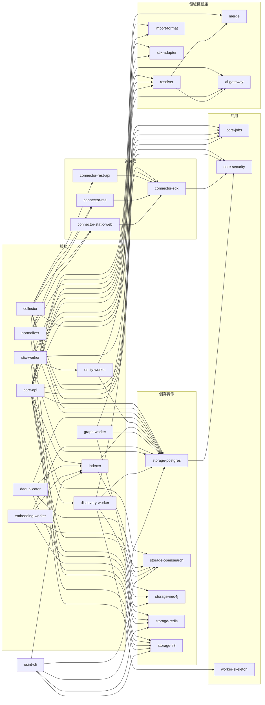

# 原始碼地圖

這一頁把 repo 裡的 35 個 crate（Rust 的套件單位）分組列出，說明每一個做什麼、彼此怎麼相依，以及建議從哪裡讀起。

每個 crate 的一句話職責取自該 crate `src/lib.rs` 或 `src/main.rs` 頂部的文件註解，並對照過實際內容。
要深入某一個 crate 時，**先讀那段頂部註解**——這個專案習慣把「為什麼這樣設計」寫在那裡。

---

## repo 頂層目錄

| 路徑 | 放什麼 |
|---|---|
| `crates/` | 全部 35 個 Rust crate，這一頁的主角 |
| `migrations/postgres/`、`migrations/sqlite/` | 資料庫結構變更檔（migration），兩種後端各一份、編號一一對應 |
| `config/default.toml` | 所有服務的預設設定；可用 `OSINT_CONFIG_FILE` 指向另一份 TOML，或用 `OSINT__` 開頭的環境變數覆蓋 |
| `docker/` | `Dockerfile`（10 個服務共用一份多階段建置）、`docker-compose.yml`（基礎設施＋應用服務）、`docker-compose.dev.yml`（本機開發覆寫） |
| `scripts/` | 開發輔助腳本：產生測試用 API 憑證（`dev-token.py`）、部署 OpenSearch 向量模型、公開 repo 匯出、密鑰掃描自我檢查 |
| `docs-site/` | 你正在讀的文件網站（MkDocs） |
| `docs/` | 內部文件：版本規格（`docs/specs/`）、架構決策紀錄、開發者筆記（`docs/developer/`）、已知缺口實錄 |
| `.github/workflows/` | CI（持續整合）流程：格式與 lint、密鑰掃描、相依套件稽核、單元與整合測試、容器建置與掃描 |
| `Makefile` | 常用指令的入口，`make help` 列出全部 |
| `Cargo.toml`、`Cargo.lock`、`rust-toolchain.toml` | workspace（多個 crate 共用的建置單位）定義、鎖定的相依版本與工具鏈 |
| `.cargo/config.toml` | 編譯設定：限制平行編譯數、關掉增量編譯並減少除錯資訊，控制 `target/` 的磁碟用量 |
| `deny.toml` | 相依套件授權與安全公告的檢查規則（`cargo deny`） |
| `target/`、`var/` | 編譯產物與本機 SQLite 檔。都不進版本控制 |

!!! warning "注意磁碟"
    `target/` 會隨相依變動持續累積。開工前跑 `make disk` 看一下大小，太大就 `make clean`。

---

## 服務（10 個）

每個服務是一個獨立執行檔，也都有自己的容器。除了 `osint-api` 之外，服務之間不互相呼叫，只透過 Redpanda（Kafka 相容的訊息佇列）上的事件串起來。

| crate | 執行檔 | 職責 | 訂閱 → 發布 |
|---|---|---|---|
| `core-api` | `osint-api` | 對外唯一的 REST API：認證、RBAC（角色權限控管）、稽核、匯入上傳、搜尋、Discovery 觸發 | 發布 `job.dispatched`、`raw.collected`（匯入） |
| `collector` | `osint-collector` | 讀取啟用中的連接器，依 cron 排程收集；同時執行數受全域與每網域上限限制 | 發布 `raw.collected` |
| `normalizer` | `osint-normalizer` | 把原始證據整理成 Document（RSS／Atom、HTML、帶欄位對映的 JSON／CSV） | `raw.collected` → `object.normalized` |
| `deduplicator` | `osint-deduplicator` | 五階段去重，只標記不刪除 | `object.normalized` → `dedup.completed` |
| `entity-worker` | `osint-entity-worker` | 用確定性規則抽出 CVE、IP、網域等實體，建立關聯與溯源 | `dedup.completed` → `entity.extracted`、`relationship.changed` |
| `indexer` | `osint-indexer` | 把 Document 與實體寫進 OpenSearch；**同時**是搜尋查詢語法的唯一實作（`core-api` 與 `osint-cli` 都呼叫它） | `entity.extracted` |
| `graph-worker` | `osint-graph-worker` | 把實體之間的關係投影到 Neo4j；也執行圖重建工作 | `relationship.changed`、`job.dispatched` |
| `embedding-worker` | `osint-embedding-worker` | 把 Document 與 Entity 的文字轉成向量寫進 OpenSearch | `entity.extracted` |
| `stix-worker` | `osint-stix-worker` | 執行 STIX 2.1 匯入與匯出工作 | `job.dispatched` |
| `discovery-worker` | `osint-discovery-worker` | 執行 Discovery 工作：從實體出發做圖擴張，產生候選 | `job.dispatched` |

`indexer`、`graph-worker`、`embedding-worker` 支援 `--rebuild`（從 PostgreSQL 重建投影後結束）與 `--rebuild --drop`（先清空再重建）。`stix-worker` 與 `discovery-worker` 沒有重建模式：它們的產出不是可重建的投影。

!!! note "`discovery-worker` 頂部註解是舊的"
    `crates/discovery-worker/src/lib.rs` 與 `main.rs` 頂部仍寫著「只有骨架、一律標記失敗」。
    實際上 `main.rs` 已經呼叫 `graph_expansion.rs` 的圖擴張邏輯並把工作標成完成。以程式為準。

---

## 工具（2 個）

| crate | 職責 |
|---|---|
| `osint-cli` | 本機**唯讀**查詢工具。直接連 PostgreSQL 與物件儲存，不經過 API，因此不受 RBAC 與稽核保護，只在本來就能存取資料庫的機器上使用 |
| `acceptance` | 跨服務驗收測試的容器，**沒有生產程式碼**。只放需要多個服務一起才成立的測試（例如事件重送後不產生重複資料、後端暫時失效後能恢復）。會真的停掉容器的測試預設不跑 |

---

## 領域與共用（7 個）

幾乎每個服務都相依這一組。

| crate | 職責 |
|---|---|
| `core-model` | 全系統共用的領域型別（Source、Document、Entity、Relationship、Candidate……）；識別碼用 UUID v7；列舉值在 `enums.rs`；URL 正規化在 `url_norm.rs` |
| `core-config` | 設定載入（預設檔 → 指定檔 → 環境變數，後蓋前）；`SecretRef`（密鑰參照，設定裡只存「去哪裡拿密鑰」，不存密鑰本身） |
| `core-events` | 事件信封格式與 Redpanda 的生產者／消費者封裝；全部 topic 名稱定義在 `topics.rs` |
| `core-jobs` | Job（非同步工作）的狀態機與派工；儲存一律走 `RelationalStore` 介面，不直接寫 SQL |
| `core-observability` | JSON 結構化 log、記憶體內的 metrics 計數、health／ready 型別 |
| `core-security` | JWT（一種 API 憑證格式）、API token、RBAC、稽核介面、SSRF（伺服器端請求偽造）防護用的 IP 分類。不相依任何儲存實作 |
| `worker-skeleton` | worker 共用的 `/health`、`/ready`、`/metrics` 端點骨架。目前只有 `discovery-worker` 用它；其他 worker 各自有一份幾乎相同的 `health.rs` |

---

## 儲存介面與實作（7 個）

這是「能力導向」的儲存設計：服務邏輯只依賴 `storage-core` 裡的 trait，具體後端各自實作它真正支援的能力。

| crate | 職責 | 實作的 trait |
|---|---|---|
| `storage-core` | 所有儲存能力的 trait 定義、共用錯誤型別、health 型別、測試用的 mock，以及給每個後端跑的一致性測試（`conformance.rs`） | 定義 `RelationalStore`、`CanonicalStore`、`EmbeddedStore`、`TransactionalStore`、`SearchStore`、`ProjectionStore`、`GraphStore`、`EmbeddingProvider`、`KeyValueStore`、`ObjectStore` |
| `storage-postgres` | 正式環境的唯一真相來源。**所有 SQL 只留在這個 crate**；也實作稽核與 API token 的持久化 | `RelationalStore`、`CanonicalStore`、`TransactionalStore` |
| `storage-sqlite` | 嵌入式／本機應用用的後端，**不是**正式環境的真相來源 | `RelationalStore`、`EmbeddedStore` |
| `storage-opensearch` | 搜尋索引；另含呼叫 OpenSearch ml-commons 模型產生向量的實作 | `SearchStore`、`EmbeddingProvider` |
| `storage-neo4j` | 關聯圖投影 | `GraphStore`、`ProjectionStore` |
| `storage-redis` | 快取 | `KeyValueStore` |
| `storage-s3` | S3 相容的物件儲存（部署時是 SeaweedFS） | `ObjectStore` |

連線位址一律由呼叫端從設定注入，這些 crate 不讀環境變數、不寫死埠號。

---

## 連接器（4 個）

| crate | 職責 |
|---|---|
| `connector-sdk` | 連接器的共用基礎：`ConnectorTrait`（連接器要實作的介面）、SSRF 防護、`NetworkRule`（每個來源的私網放行白名單）、每網域限速、重試、checkpoint（增量收集進度）、把抓到的內容存成原始證據 |
| `connector-rss` | RSS 2.0／Atom 1.0。一次收集把整份 feed 存成一筆原始證據；解析函式也被 `normalizer` 拿去用 |
| `connector-static-web` | 靜態網頁。用 ETag／Last-Modified 或內容雜湊判斷有沒有新內容；解析函式也被 `normalizer` 拿去用 |
| `connector-rest-api` | REST JSON API。回應整份存成原始證據，**不拆成 Document**；憑證只能透過 `SecretRef` 提供 |

---

## 領域邏輯庫（5 個）

沒有執行檔，被服務當函式庫呼叫。

| crate | 職責 | 被誰用 |
|---|---|---|
| `resolver` | 實體解析（Entity Resolution，判斷兩個實體是不是同一個）：跑各種比對方法產生合併候選；`auto_approval.rs` 是 AI 輔助的自動核准評估 | `core-api`、`entity-worker`、`stix-worker` |
| `merge` | 執行一次實體合併與復原：在一筆交易裡改寫所有參照、記錄合併歷史。**不產生候選**（那是 `resolver` 的事） | `core-api`、`resolver` |
| `import-format` | JSON／CSV 匯入的欄位對映與有界解析。API 收檔時先解析一次、`normalizer` 產生 Document 時再解析一次，兩邊共用同一份實作 | `core-api`、`normalizer` |
| `stix-adapter` | STIX 2.1 型別、bundle 驗證、與內部物件的雙向映射。純函式，不碰儲存 | `core-api`、`stix-worker` |
| `ai-gateway` | 生成式 AI 呼叫的抽象層：OpenAI 相容端點的實作、測試用 mock、重試、限流、成本計算、敏感資訊遮蔽、依優先權的併發控管（Admission Controller） | `core-api`、`resolver`、`stix-worker` |

!!! note "有些服務 crate 也被當函式庫用"
    `indexer`（搜尋查詢語法與索引 schema）、`entity-worker`（衍生 ID 的產生規則）、
    `discovery-worker`（Discovery 工作類型常數）同時有執行檔與函式庫。
    例如 `stix-worker` 匯入時直接重用 `entity-worker` 的 ID 產生函式，確保同一個實體不管從哪條路進來都是同一個 ID。

---

## 相依方向圖

下圖由 `cargo metadata --format-version 1 --no-deps` 取得 workspace 內部的正式相依（不含測試用的開發相依）。
箭頭方向是「A → B」表示 A 相依 B。

為了可讀性，**省略了五個幾乎人人都相依的基礎 crate**：
`core-model`（25 個 crate 相依）、`storage-core`（22 個）、`core-events`（14 個）、`core-config`（12 個）、`core-observability`（12 個）。

從圖上可以讀出幾件事：

| 觀察 | 意義 |
|---|---|
| `core-api` 相依最多 | 它是唯一的對外入口，許多功能（搜尋、合併、解析、STIX 驗證）直接在請求內呼叫函式庫完成 |
| `core-api` 相依 `discovery-worker` | 只為了共用 Discovery 工作類型的常數，不是呼叫它的執行邏輯；實際執行仍透過 `job.dispatched` 交給 worker |
| `storage-sqlite` 不在圖上 | 沒有任何服務在正式路徑上用它，只有部分 crate 的測試用它當輕量後端 |
| 連接器只相依 `connector-sdk` 與 `core-model` | 新增連接器不需要碰儲存或事件，那些由 SDK 與 `collector` 處理 |
| `resolver` → `merge`，反過來沒有 | 「產生候選」與「執行合併」刻意分開，合併本身不知道候選從哪來 |

---

## 從哪裡讀起

建議順序，每一步都建立在前一步上：

| 順序 | 讀什麼 | 為什麼先讀它 |
|---|---|---|
| 1 | `crates/core-model/src/` | 所有服務傳來傳去的都是這些型別。先知道 Document、Entity、Relationship、Provenance（溯源）長什麼樣，後面每個服務都只是在轉換它們 |
| 2 | `crates/storage-core/src/traits.rs` | 服務怎麼存取資料全在這裡定義。讀完就知道「哪些能力存在」；`storage-postgres` 只是它的實作 |
| 3 | `crates/core-events/src/topics.rs` 與 `kafka.rs` | 服務之間的唯一溝通管道。知道有哪些 topic、消費端怎麼提交進度 |
| 4 | `crates/normalizer/` → `deduplicator/` → `entity-worker/` → `indexer/` | 照資料流的順序讀主要管線。每個 crate 都是「收事件 → 從 PostgreSQL 重讀 → 處理 → 寫回 → 發下一個事件」的同一個模式，讀完第一個後面會越來越快 |
| 5 | `crates/core-api/src/routes.rs` | 全部 API 路由與權限分組在這一個檔案。從這裡往 `resources/` 底下找個別處理函式 |
| 6 | `crates/collector/` 與 `connector-sdk/` | 收集端與 SSRF 防護。安全相關的邏輯集中在這裡 |
| 7 | `crates/resolver/`、`merge/`、`discovery-worker/` | V0.2～V0.3 的情報分析功能。這幾個邏輯最複雜，留到熟悉基本模式後再讀 |

!!! note "每個 crate 都有對應的開發者筆記"
    `docs/developer/` 底下大多數服務與函式庫都有一份同名的 `.md`（例如 `deduplicator.md`、`connector-sdk.md`），
    記錄設計取捨與已知限制。`docs/developer/local-dev.md` 是本機開發環境的完整說明。
